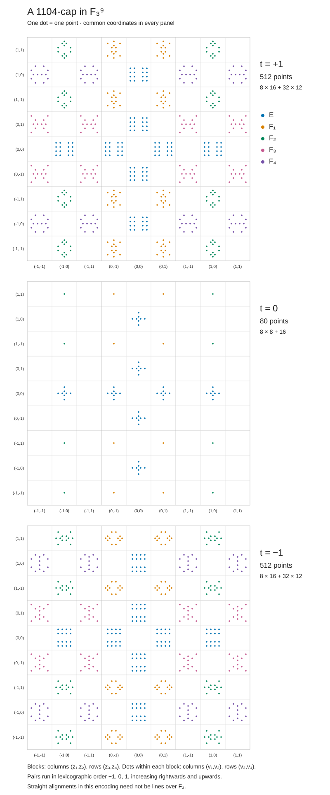

# A 1104-cap in dimension nine

Companion package for **Matt Holden, _A 1104-cap in dimension nine_**.
The manuscript is being prepared for arXiv; a preprint link will be added when available.

The construction gives 1104 points in $\mathbb F_3^9$ with no three distinct
points on a line. Its three parallel layers have sizes **512, 80, 512**.
Both outer layers are linearly equivalent to the published FunSearch 512-cap.
The construction is a reflection lift of the classical Calderbank–Fishburn
236-cap. To the best of our knowledge, 1104 improves the published
dimension-nine lower bound of 1082; no claim of optimality is made.

## Verify it

Use **Python 3.9 or later**. All scripts use only the standard library and run
offline. From this directory:

```sh
python3 construction.py --check
python3 verify.py
python3 verify_funsearch.py
python3 make_atlas.py --check
python3 -m unittest -v
```

The checks establish:

- The saved CSV exactly matches the coordinate recipe.
- There are 1104 distinct ternary vectors spanning affine dimension nine.
- The layers at $t=+1,0,-1$ have sizes 512, 80, 512.
- All **608,856 unordered pairs** are checked: the third point $-x-y$ is absent.
  This includes pairs whose third point would be in another layer.
- The displayed map has rank eight and sends each outer layer exactly onto
  the independently generated FunSearch cap. Its four parts each have 128
  points, and all **130,816 pairs** in that cap are checked as well.
- The saved atlas matches the CSV. Its plotted positions decode back to the
  original coordinates, with one dot per point.
- Small negative controls confirm that the checker rejects lines, duplicates,
  and malformed input.

These finite checks accompany the mathematical proofs in the paper. They do
not certify historical priority or prove the sharp bound for the whole lifting family.

To regenerate the two saved artifacts:

```sh
python3 construction.py
python3 make_atlas.py
```

## Contents and coordinates

| File | Purpose |
| --- | --- |
| [construction.py](construction.py) | Implements the paper's fiber table and layer recipe. |
| [data/cap1104.csv](data/cap1104.csv) | All 1104 points, sorted lexicographically, with a header. |
| [verify.py](verify.py) | Checks the point list without importing the generator. |
| [verify_funsearch.py](verify_funsearch.py) | Checks the linear maps against the published predicate. |
| [make_atlas.py](make_atlas.py) | Renders the CSV as a standalone SVG. |
| [test_verify.py](test_verify.py) | Negative controls and an atlas round-trip test. |

Each CSV row has coordinate order

```text
t,z1,z2,z3,z4,v1,v2,v3,v4
```

Arithmetic is modulo three. The CSV uses **0, 1, 2**, where **2 represents −1**
in the paper. In particular, `t=2` is the minus layer. Numeric CSV sorting puts
the middle layer first; the atlas displays the layers in the order +1, 0, −1.

The SHA-256 of the saved CSV, including its header and LF line endings, is:

```text
5a5077411a9123d4e013c3f808bc159649e2acaeac153d271eba54c7617bd791
```

## Reading the atlas



Every panel has a 9-by-9 grid of blocks. Block columns encode $(z_1,z_2)$ and
block rows encode $(z_3,z_4)$. Within each block, 9-by-9 possible dot positions
encode $(v_1,v_2)$ horizontally and $(v_3,v_4)$ vertically. Pairs are ordered
lexicographically with $-1<0<1$, increasing rightwards and upwards. The same
arrangement and scale are used in every panel (the paper's A1 arrangement).

The blue blocks have addresses in $E=\{\pm e_1,\ldots,\pm e_4\}$; the other
four colors indicate $F_i$, the addresses whose only zero coordinate is $i$.
An occupied block contains a copy of a four-coordinate fiber. Each dot is one
cap point, and the panel supplies its ninth coordinate. Straight alignments
on the page need not be lines over $\mathbb F_3$.

## The FunSearch comparison

The target predicate is specified by Romera-Paredes et al., **Figure 4c and
Supplement Figure E.23**. `verify_funsearch.py` evaluates those mathematical
conditions on all $3^8$ vectors. It uses zero-based indices $x_0,\ldots,x_7$.
The map from the plus layer is:

```text
x = (z3, -v2+v4, -v1-v3, z1-z2, z4, z1+z2, v1-v3, v2+v4) mod 3.
```

For the minus layer, first apply the involutory permutation
`(z2,z1,z3,z4,v3,v4,v1,v2)`, which exchanges the outer layers.
The checks compare complete sets, not just sizes or numerical invariants.

The predicate was also checked against the authors'
[official point list at a fixed revision](https://github.com/google-deepmind/funsearch/blob/cc53f274237d7ab05c19df939edbc1f9616a7c19/cap_set/n8_size512.txt).
To repeat that additional check, download that file and run:

```sh
python3 verify_funsearch.py --official-points /path/to/n8_size512.txt
```

## Attribution

- Calderbank and Fishburn, _Maximal three-independent subsets of {0,1,2}^n_,
  Designs, Codes and Cryptography **4** (1994), 203–211: the classical 236-cap.
- Edel and Bierbrauer, _Large caps in small spaces_, Designs, Codes and
  Cryptography **23** (2001), 197–212, Theorem 5 and Table 2:
  [the explicit classical model, corrected author version](https://www.yvesedel.de/Papers/smallCaps.pdf).
- Romera-Paredes et al., _Mathematical discoveries from program search with
  large language models_, Nature **625** (2024), 468–475:
  [FunSearch and its explicit 512-cap](https://doi.org/10.1038/s41586-023-06924-6).
  That paper already gives an explicit support/reflection recipe and discusses
  its resemblance to Hill's cap.
- [Gijswijt's 2024 survey, Table 1](https://www.nieuwarchief.nl/serie5/pdf/naw5-2024-25-1-045.pdf)
  records the prior dimension-nine lower bound of 1082.
- Recursive and fiber constructions are classical; see
  [Edel–Bierbrauer (1999)](https://www.yvesedel.de/Papers/RCap.pdf) and
  [Edel (2004)](https://www.yvesedel.de/Papers/ExtProd.pdf).

The code here is a self-contained implementation of the stated mathematical
recipes. It does not bundle FunSearch's search implementation or notebook.
The package's code, documentation, and generated artifacts are available under
the [MIT license](LICENSE). Please cite the paper and the relevant original
sources when using the construction.
